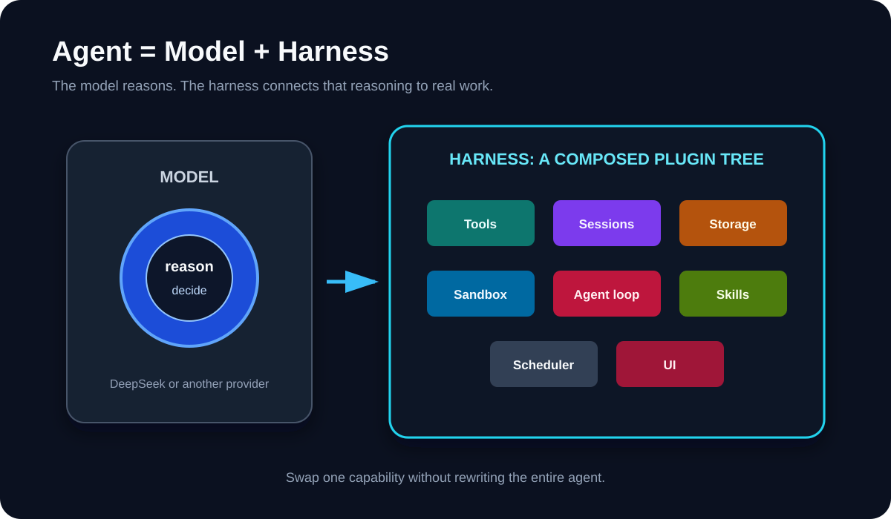
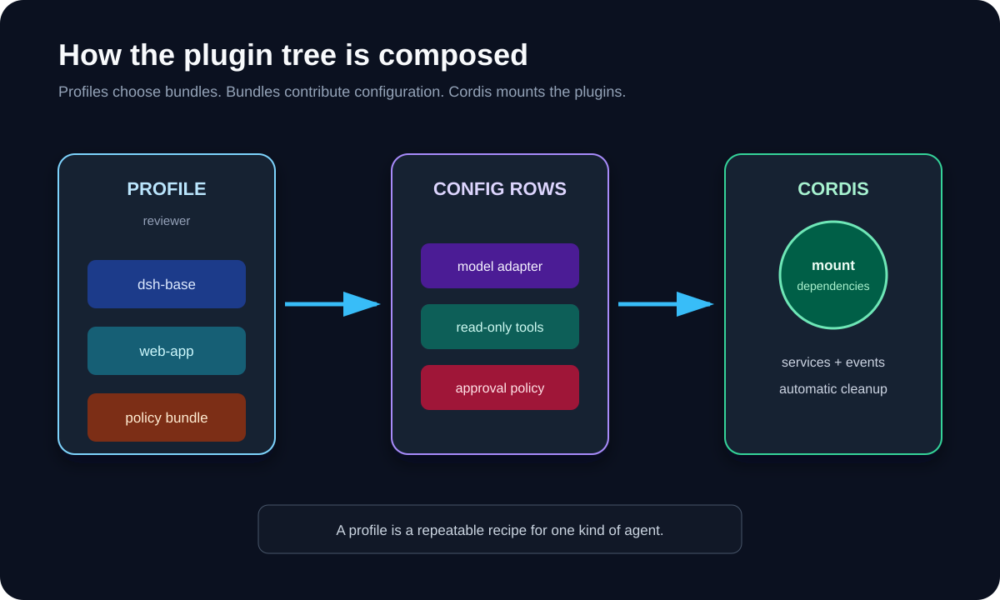
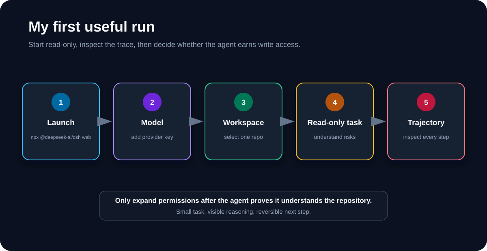

I went through the new [DeepSeek Harness](https://github.com/deepseek-ai/deepseek-harness) repo and documentation because the tagline sounded almost too broad:

```text
Everything is a plugin.
```

It is not just marketing. The model adapter, tools, skills, sessions, storage, sandbox, agent loop, scheduler, and even the UI are composed as plugins.

My short version:

```text
DeepSeek Harness is a coding agent,
but its more interesting use is building your own coding agent.
```

{: .align-center}

## What is a harness?

A model can generate text and tool calls. The harness is everything around it that turns those calls into useful work:

- choosing and calling the model
- exposing files, shell, web search, and other tools
- managing context and sessions
- asking for approval
- applying sandbox rules
- running subagents and workflows
- recording what happened

DeepSeek describes the idea as:

```text
Agent = Model + Harness
```

That feels right. A strong model inside a weak harness can still be clumsy. A good harness gives the model the right tools, boundaries, memory, and feedback loop.

## What "everything is a plugin" means

DeepSeek Harness is built on [Cordis](https://arxiv.org/abs/2608.25512), a composition framework that manages plugin dependencies and cleanup.

A running Harness is a plugin tree. Plugins contribute services and events to a shared context. If a required service is missing, a dependent plugin waits. When a plugin unloads, its registrations are removed with it.

This makes a few useful swaps possible:

```text
DeepSeek model     -> another model provider
local shell        -> another execution backend
default web search -> another search provider
standard tools     -> a smaller, locked-down tool set
Web UI             -> a headless or custom client
default loop       -> a different agent loop
```

The point is not to install every plugin I can find. The point is that I can replace one part without forking the whole agent.

{: .align-center}

## The fastest way to try it

Install Node.js, open the project I want the agent to work on, then run:

```bash
npx @deepseek-ai/dsh web
```

The Web UI starts at `http://127.0.0.1:3080` by default.

Then I would:

1. Open **Settings -> Models**.
2. Add a DeepSeek API key, or configure another supported provider.
3. Choose the current project as the workspace.
4. Start one small, read-heavy task.

For example:

```text
Read this repository. Explain its main packages,
then list three risky areas. Do not edit anything yet.
```

That is a better first test than asking it to rebuild the project. I can check whether it understands the codebase before giving it write access.

{: .align-center}

## The four included modes

DeepSeek ships four useful ways to compose the agent:

- **Standard**: the normal coding agent with files, shell, search, skills, planning, goals, subagents, and workflows.
- **Code**: Standard mode plus a TypeScript SDK that lets the model combine several tool operations in one generated program.
- **Minimal**: only persistent Bash and a file editor; useful for cleaner model benchmarks.
- **Creator**: Standard mode plus runtime inspection and plugin experiments for building new presets.

I would start with Standard. Creator is the interesting one after I understand the normal workflow.

## Profiles, bundles, and plugins

The naming took me a minute:

```text
Plugin  = one capability loaded by Cordis
Bundle  = a package that contributes a configuration layer
Profile = an ordered set of bundles I can boot
```

Profiles let me keep different agents without editing the shipped setup. One profile could be a normal coding assistant. Another could be a read-only reviewer with fewer tools.

To inspect the configuration that actually boots:

```bash
dsh --profile web --dump-config
```

For a packaged plugin bundle, the documented flow is:

```bash
dsh plugin --profile demo add dsh-my-plugin
dsh --profile demo --dump-config
dsh --profile demo
```

The important habit is to create my own profile or patch. I would not edit the built-in presets because upgrades can replace them.

## A practical plugin idea

My first real plugin would be boring: a repository policy checker.

It could add one read-only tool:

```text
check_repository_policy
```

The tool could inspect whether:

- tests exist for changed code
- generated files were edited by hand
- secrets appear in the diff
- required documentation changed
- the repository's own rules were followed

This is a good plugin because it has a narrow input, predictable output, and no reason to modify files. Once it works, I could add it to a reviewer profile instead of every agent.

At the code level, a Harness plugin is a TypeScript module with an `apply(ctx)` function. A tool plugin declares the `tools` dependency and registers its schema and implementation through `ctx.tools`. Cordis handles its lifecycle when the plugin mounts or unloads.

## The trace may matter as much as the plugins

DeepSeek Harness records what the model sees in an append-only session log: prompts, reasoning, tool calls, results, subagent scheduling, and context injection.

The Trajectory view uses that event stream, and resume, fork, search, and replay build on the same history.

That is useful when an agent gets something wrong. I do not just see the final answer. I can inspect which context it received, which tool it called, and where the run changed direction.

## What I would be careful about

This is still a developer preview. The repo explicitly warns that compatibility-breaking changes will happen, and the project has not had a security audit.

Plugins are executable code, not browser extensions with a magic safety wall. They can reach whatever the Harness process and its tools are allowed to reach.

My rules would be:

```text
Use a disposable project first.
Keep permissions narrow.
Review plugin source before installing it.
Pin third-party Git plugins to a commit.
Keep secrets out unless the task truly needs them.
Do not treat the sandbox as the only security boundary.
```

## My conclusion

DeepSeek Harness is not the easiest coding agent for someone who only wants to type a prompt and get a patch.

It is more interesting for developers who want to shape the agent itself: swap models, reduce tools, add company-specific checks, build a headless worker, or inspect the full execution trail.

The idea I am taking away is simple:

```text
Do not build one giant agent.
Compose the smallest agent that fits the job.
```

That is where "everything is a plugin" becomes practical.

## Sources

- [DeepSeek Harness announcement](https://www.deepseek.com/harness/en/)
- [deepseek-ai/deepseek-harness repository](https://github.com/deepseek-ai/deepseek-harness)
- [DeepSeek Harness quickstart](https://deepseek-harness.github.io/deepseek-harness/en/guide/quickstart)
- [DeepSeek Harness architecture](https://deepseek-harness.github.io/deepseek-harness/en/reference/)
- [Configure model providers](https://deepseek-harness.github.io/deepseek-harness/en/guide/providers)
- [Your first Harness plugin](https://deepseek-harness.github.io/deepseek-harness/en/develop/basic/)
- [Package and install a plugin](https://deepseek-harness.github.io/deepseek-harness/en/develop/basic/publish)
- [DeepSeek Harness safety notice](https://github.com/deepseek-ai/deepseek-harness/blob/master/SAFETY.md)
- [Cordis paper: A Programming Paradigm for Spatiotemporal Composability](https://arxiv.org/abs/2608.25512)
