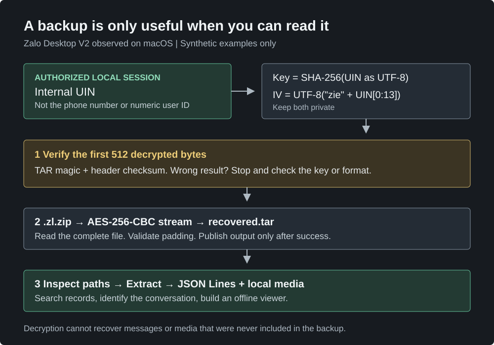

I wanted to preserve a conversation from an authorized Zalo account as a searchable, offline archive. The export ended in `.zl.zip`, but neither a ZIP tool nor a TAR reader could open it.

The file was **an AES-encrypted TAR archive**, not an ordinary ZIP. Once I recovered the correct account-specific value from the signed-in desktop app, the rest was standard decryption and data processing.

This describes the Desktop V2 format I verified on macOS in September 2026. It is not a universal recipe for Android, iPhone, cloud backups, or every Zalo version. All identifiers, messages, and key material in the examples below are synthetic.

{: .align-center}

## 1. Identify the file before trying to unzip it

Start with a copy or a read-only source, and inspect its contents:

```sh
file backup.zl.zip
xxd -l 32 backup.zl.zip
shasum -a 256 backup.zl.zip
```

My file lacked a normal ZIP signature, and an archive reader reported an unrecognized format. That suggested another layer, but did not by itself prove encryption or rule out corruption.

Inspecting the installed app's backup code confirmed the sequence:

```text
Export: files -> TAR -> AES-256-CBC -> .zl.zip
Import: .zl.zip -> AES-256-CBC -> TAR -> files
```

On macOS, the relevant application bundle was `Zalo.app/Contents/Resources/app.asar`. Useful search terms were `getCipherKey`, `getFormattedIv`, and `getDecipherV2`. I also found a separate legacy V1 branch, so I did not assume one algorithm covered both formats.

## 2. The numeric user ID was not the key input

The V2 code derived its key and IV from an internal **UIN string**:

```javascript
import { createHash, createDecipheriv } from 'node:crypto';

// Invented example. This will not decrypt a real user's backup.
const uin = '0123456789abcdef0123456789abcdef';

const key = createHash('sha256').update(uin, 'utf8').digest();
const iv = Buffer.from('zie' + uin.slice(0, 13), 'utf8');
const decipher = createDecipheriv('aes-256-cbc', key, iv);
```

Three details matter:

- Hash the UIN **as text**, even if it looks like hexadecimal.
- Use the 32 raw hash bytes as the AES key, not the 64-character hex representation.
- The numeric account ID and phone number are not substitutes for this UIN.

The IV construction above describes the implementation I observed; it is not a recommendation for designing a new encryption scheme. Knowing this formula alone does not provide another account's UIN.

## 3. Recover the UIN from the authorized local session

I used the owner's already signed-in desktop session. After quitting Zalo normally, I launched it with a debugger bound to the local machine:

```sh
open -na /Applications/Zalo.app --args \
  --remote-debugging-address=127.0.0.1 \
  --remote-debugging-port=9229

lsof -nP -iTCP:9229 -sTCP:LISTEN
curl -sS http://127.0.0.1:9229/json
```

Confirm that the listener is on loopback, not a public network interface. In Chrome's `chrome://inspect`, configure `localhost:9229` and inspect the main Zalo `index.html` target, not a notification or worker window. The target's ID changes between launches.

In the build I inspected, the main page's React state exposed UIN in these locations:

```text
fiber.memoizedProps.user.UIN
fiber.stateNode.fetcher.UIN
fiber.stateNode.storage.UIN
```

<details>
<summary>Local inspection snippet for that React build</summary>
<div markdown="1">

Run in the main renderer's DevTools console. The result is sensitive: keep it local and out of screenshots, source control, and shared logs.

```javascript
(() => {
  const app = document.getElementById('app');
  if (!app) return [];
  const field = Object.keys(app).find(k => k.startsWith('__reactContainer'));
  const stack = [app[field]], seen = new Set(), candidates = new Set();

  while (stack.length && seen.size < 30000) {
    const fiber = stack.pop();
    if (!fiber || seen.has(fiber)) continue;
    seen.add(fiber);
    for (const uin of [
      fiber.memoizedProps?.user?.UIN,
      fiber.stateNode?.fetcher?.UIN,
      fiber.stateNode?.storage?.UIN,
    ]) {
      if (typeof uin === 'string' && uin.length === 32) candidates.add(uin);
    }
    for (const next of [fiber.child, fiber.sibling, fiber.alternate]) {
      if (next) stack.push(next);
    }
  }
  return [...candidates];
})()
```

These are private implementation details, not a supported Zalo API. An empty result can mean a different build, the wrong renderer, or an incomplete login. A candidate is not a verified key until it decrypts the actual backup header.

</div>
</details>

Keep the verified UIN in a local UTF-8 file such as `uin.private.txt`, restricted to its owner. Then quit the debugging instance and confirm the listener is gone:

```sh
osascript -e 'tell application "Zalo" to quit'
lsof -nP -iTCP:9229 -sTCP:LISTEN
```

Subsequent decryption can run offline without reopening Zalo. If neither the correct UIN nor an authorized session is available, this procedure cannot recover it from a display name or numeric ID.

## 4. Verify 512 bytes, then decrypt the complete stream

A plausible filename is weak evidence. I checked the decrypted first TAR block for both:

1. The `ustar` marker at byte offset 257.
2. The TAR header checksum, calculated with bytes 148 through 155 treated as spaces.

For this 512-byte probe, padding is disabled because the end of the encrypted file has not been read. For the complete file, padding stays enabled. Node's [decipher documentation](https://nodejs.org/api/crypto.html#class-decipheriv) covers this distinction.

The [small Node.js helper](/assets/code/zalo-backup/decrypt.mjs) implements both operations using built-in modules:

```sh
node decrypt.mjs verify backup.zl.zip uin.private.txt
node decrypt.mjs decrypt backup.zl.zip uin.private.txt recovered.tar
```

It streams the data, refuses to overwrite existing output, and leaves failed output as `.partial`. It does not print the UIN or derived key. A successful header check is only a preliminary check: finish decryption, check padding, inspect the archive, and parse the records.

For my original recovery, I also compared the SHA-256 of a second full decryption with the previously recovered TAR. They matched. **A matching hash proves those outputs agree; it is not proof of authenticity.** This CBC format has no authentication tag.

### Try it without private data

Download these two files into an empty working directory:

- [decrypt.mjs](/assets/code/zalo-backup/decrypt.mjs)
- [make-demo.py](/assets/code/zalo-backup/make-demo.py)

With Python 3 and Node.js 22 or later:

```sh
python3 make-demo.py
node decrypt.mjs verify demo.zl.zip demo-uin.txt
node decrypt.mjs decrypt demo.zl.zip demo-uin.txt recovered.tar
tar -tf recovered.tar
```

The generator creates a tiny encrypted TAR with two invented messages and a publicly known fake UIN. Successful verification reports:

```text
TAR header verified
First entry: 9000000000000000001/ZaloDownloads/database/9000000000000000001_zmessage.zdb
```

This is a reproducible demonstration of the format, not a Zalo-generated backup.

## 5. Inspect the TAR, then read JSON Lines

Before extraction, reject absolute paths, `..` components, links, device entries, and duplicate destinations. Extract into a new directory. Python provides [TAR extraction filters](https://docs.python.org/3/library/tarfile.html#extraction-filters), but those do not remove the need for resource limits and archive inspection.

The [companion extraction helper](/assets/code/zalo-backup/extract.py) accepts only files and directories, applies a declared size limit, and refuses an existing output directory:

```sh
# Python 3.9+. Size limit is total declared file content, in GiB.
python3 extract.py recovered.tar recovered 1
```

The message database in my export had a misleading extension too: **`_zmessage.zdb` contained JSON Lines, not SQLite**. Each physical line was one JSON object.

The synthetic archive illustrates the structure:

```text
9000000000000000001/
  ZaloDownloads/database/
    9000000000000000001_zmessage.zdb
```

Search parsed records rather than treating the whole file as one JSON document:

```python
import json

path = ('recovered/9000000000000000001/ZaloDownloads/database/'
        '9000000000000000001_zmessage.zdb')

with open(path, encoding='utf-8') as stream:
    for line_number, line in enumerate(stream, 1):
        if not line.strip():
            continue
        record = json.loads(line)  # Report errors; do not silently skip records.
        message = record.get('message')
        if isinstance(message, str) and 'coffee' in message.casefold():
            print(line_number, record['fromUid'], record['toUid'], message)
```

Keep long IDs as strings. Search both message directions, verify the peer against a known message, and distinguish direct chats from groups. A matching display name alone is insufficient.

One subtle parser trap: Python's `str.splitlines()` also splits on Unicode separators that can appear inside a JSON string. Iterating the file by physical lines avoided false "corrupt record" reports in this recovery.

## 6. Preserve what is actually there

Text recovery and media recovery are separate jobs. I checked local resource folders first, recorded missing assets, and built an offline HTML viewer using relative file paths.

A media URL in a message does not guarantee the file still exists online. A call-duration record is not a recording of the call. And a conversation visible on a phone may be absent from a desktop export entirely.

For a useful archive, I keep the source backup, recovered records, local media, a manifest of missing files, and the viewer together. The private UIN/key profile stays outside the public project. Screenshots and real conversations are unnecessary for explaining the technique: a synthetic fixture is easier to reproduce and safer to share.
