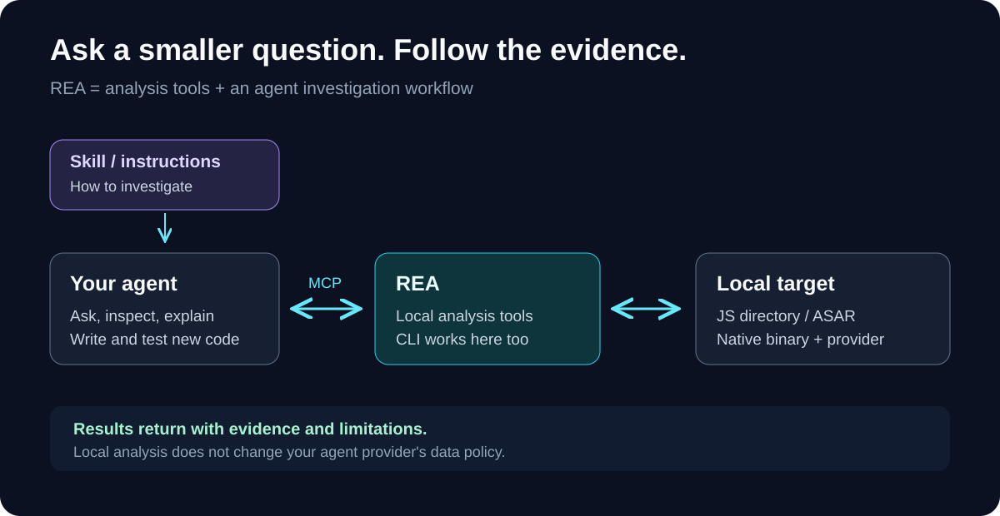
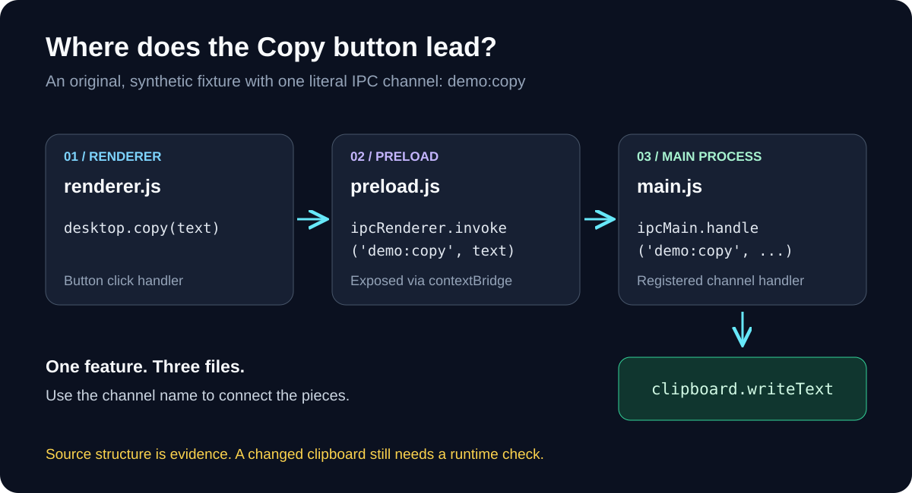
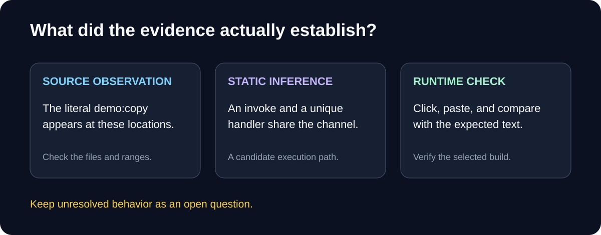

I came across [REA](https://github.com/morluto/rea) while looking at agent skills. The name stands for *Reverse Engineer Anything*, which made me curious enough to read through the docs and try a small example.

The useful question for me is pretty ordinary: **where does this button lead, and what code actually does the work?**

## What REA adds

REA gives an agent tools to inspect software: JavaScript/Electron packages, native binaries, .NET assemblies, and websites. The agent asks questions, calls the tools, and works through the returned evidence. There is also a CLI for direct inspection. Native decompilation uses a separate analysis provider such as Hopper, Ghidra, or IDA. [Project overview](https://github.com/morluto/rea#how-rea-works).

There are two parts worth distinguishing:

- **The skill** gives the agent investigation instructions.
- **The MCP server** exposes the analysis tools.

Installing the skill alone does not register the server. The project's setup command installs matching instructions and configures the connection. [Setup documentation](https://github.com/morluto/rea/blob/main/docs/installation.md#skill-only-installation).

{: .align-center}

## The smallest useful experiment

I started with static Electron analysis because it needs no native decompiler and does not run the target application. REA reads a directory or an `app.asar` archive and reconstructs the relationships it can recover from the files. [Static analysis guide](https://github.com/morluto/rea/blob/main/docs/javascript-artifact-reconstruction.md).

For this example, use Node.js **22.19+ within 22.x, 24.11+ within 24.x, or 26+**, plus npm. These are the [package's supported Node versions](https://github.com/morluto/rea/blob/main/package.json). On Linux, also have a procps-compatible `ps` on your PATH.

Download and unzip my [small clipboard fixture](/assets/code/rea-clipboard-demo.zip), then open a terminal inside its `rea-demo` folder:

```bash
npx -y rea-agents@6.5.0 analyze-javascript-application "$PWD" --json > ../demo-evidence.json
```

This is an original source fixture, not a packaged app. You do **not** need to install Electron or run `npm install` inside it. Keep the output outside the input folder. The CLI returns a complete evidence record; real applications can produce large files. [CLI guide](https://github.com/morluto/rea/blob/main/docs/cli.md).

The fixture has one clipboard operation:

```javascript
// preload.js
copy: (text) => ipcRenderer.invoke('demo:copy', text)

// main.js, inside the matching ipcMain.handle callback
clipboard.writeText(text);
```

My run with REA 6.5.0 found one exposed bridge member, one main-process handler, and one paired renderer transmission on the literal channel `demo:copy`. There were no JavaScript parse failures.

{: .align-center}

The channel name gives me a useful place to start reading. In a larger application, I would pick one equally specific feature: an export button, a search request, or a clipboard action.

## Let the agent investigate

To connect REA to Codex:

```bash
npx rea-agents@6.5.0 setup --client codex
```

Review the proposed changes, approve the ones you want, then restart the agent. Running setup without `--client codex` opens the agent chooser. Setup can also offer Hopper; this JavaScript example does not need it. [Installation guide](https://github.com/morluto/rea/blob/main/docs/installation.md#start-setup).

My first prompt would be:

```text
Use REA to inspect /absolute/path/to/rea-demo with static analysis.
Trace the demo:copy channel from the exposed desktop.copy API
to the main-process handler. Show the file locations and evidence.
Separate source observations, inferred relationships, and unknowns.
Do not launch the application or change files.
```

Replace the path with your extracted folder. REA's [feature tracing workflow](https://github.com/morluto/rea/blob/main/docs/javascript-application-workflows.md#feature-tracing) can follow a literal channel, API, route, or string through the recovered graph.

## What I would check before using the result

A matching channel is evidence of a possible connection. It does not prove the handler registered or that a clipboard write happened. REA's [graph documentation](https://github.com/morluto/rea/blob/main/docs/javascript-application-graph.md#evidence-and-authority) keeps observations, inferences, and unknowns separate.

{: .align-center}

For a real app, I would verify the behavior, write down the requirement, then implement and test my own version. For copying text, Electron's existing clipboard API is enough; REA becomes useful when the path to it is buried in unfamiliar code.

I would use software I own or have permission to inspect. Analysis runs locally, but tool results passed to an agent are still subject to its model provider's data policy. [REA FAQ](https://github.com/morluto/rea#faq).

That is the part I like: start with one question I can verify, follow the evidence, and keep the unanswered parts visible.

*Checked on October 17, 2026 with the published `rea-agents@6.5.0` package. The example commands pin that version because repository documentation can move ahead of npm releases.*
