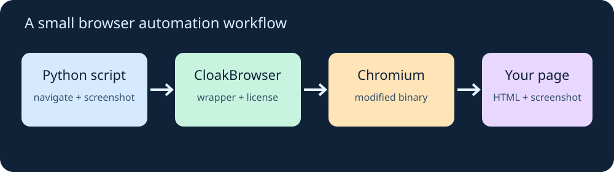
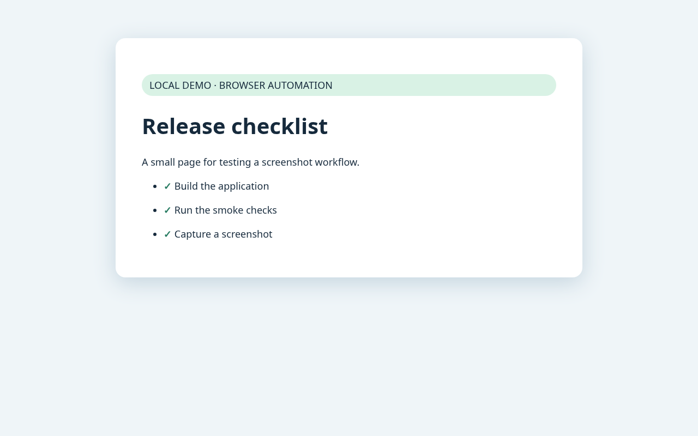

I came across [CloakBrowser](https://github.com/CloakHQ/cloakbrowser) and wanted to see how much work it takes to use it for a small browser automation task. The idea is familiar: open a browser, visit a page, and save a screenshot. The interesting part is the browser underneath.

CloakBrowser provides Python and JavaScript wrappers around a modified Chromium binary. The project says its changes are made in Chromium itself to alter browser fingerprint and automation signals. Its Python API returns Playwright-style browser objects, so much of the usual page interaction code looks familiar. These are the project's descriptions, not a guarantee that a particular site will accept an automated browser. [Project documentation](https://github.com/CloakHQ/cloakbrowser).

{: .align-center}

## A small example

I would start with a page I own, such as a local development server, and use a screenshot as a simple visual smoke check. Create a virtual environment and install the package:

```bash
python3 -m venv .venv
source .venv/bin/activate
pip install cloakbrowser==0.7.2
```

The current documentation says the first launch needs a license key, including for the free tier. You can obtain one through `cloakbrowser login` or the [free signup page](https://cloakbrowser.dev/free). For non-interactive environments, configure `CLOAKBROWSER_LICENSE_KEY` securely; keep it out of source control and logs. The first launch also downloads the browser binary, approximately 200 MB according to the project.

Save this as `capture.py`:

```python
from cloakbrowser import launch

browser = launch(headless=True)
try:
    page = browser.new_page(viewport={"width": 1280, "height": 800})
    page.goto("http://127.0.0.1:8000/", wait_until="load")
    print("Title:", page.title())
    page.screenshot(path="page.png", full_page=True)
finally:
    browser.close()
```

Download my [demo page](/assets/code/cloakbrowser-demo/index.html), put it in a folder, and run `python3 -m http.server 8000` from that folder in another terminal. Then run `python capture.py`. Inspect `page.png` and the printed title. The `finally` block closes the browser even if navigation or the screenshot fails. For a real visual regression test, compare screenshots under controlled viewport, fonts, data, and browser versions; one image alone isn't a regression test.

## What I actually verified

In a Linux environment with Python 3.12, I installed `cloakbrowser==0.7.2`, used a free key, and ran this against the local demo page. The browser returned HTTP **200**, the title was **Release checklist**, and a Playwright locator found **3** list items. This is the screenshot from that run:

{: .align-center}

My environment routes internet traffic through an HTTPS proxy. The wrapper downloaded the binary, but Chromium's own license check initially failed with a TLS error. I added the environment's trusted proxy CA to the user's Chromium certificate store and passed the proxy with `--license-route=proxy`, while bypassing the proxy for localhost. After that, the same page and screenshot calls worked. This proxy and certificate setup is specific to that environment; use your own organization's supported trust configuration and keep TLS verification enabled.

The screenshot confirms the local automation path worked; it does not test detection resistance or access to a third-party site.

The project also offers persistent profiles, proxy configuration, and optional humanized interactions. I would add those only when a specific workflow needs them; they introduce more settings to understand and test. See the [upstream README](https://github.com/CloakHQ/cloakbrowser#usage) for current options and platform support.

My takeaway: the Playwright-shaped API makes this easy to evaluate if you already have browser automation code. Treat detection-resistance claims as vendor claims, measure your own authorized workflow, and respect the target site's rules. A modified browser is not a promise of anonymity or reliable access.
