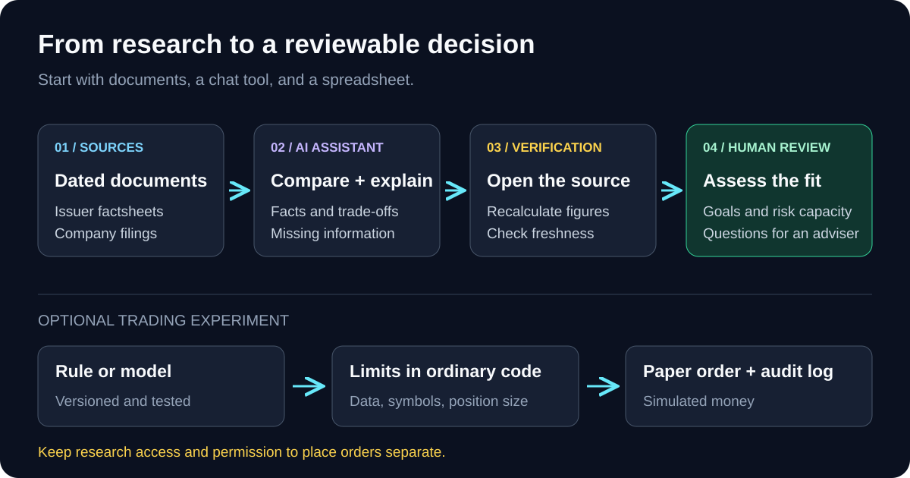
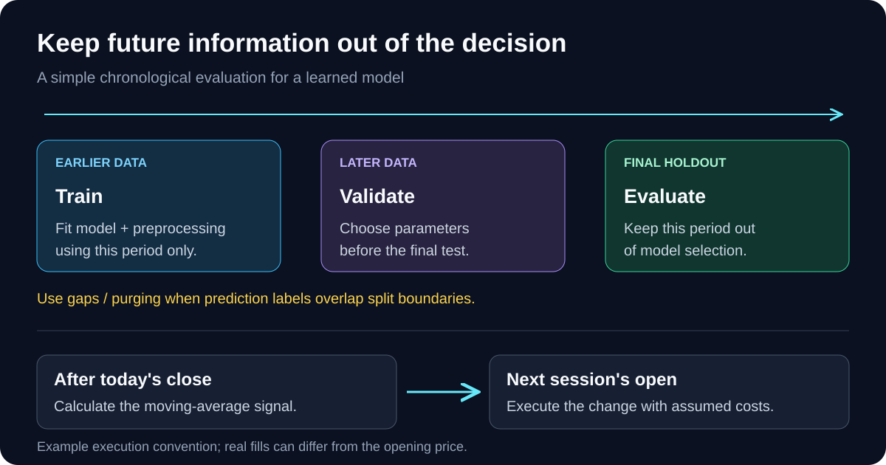
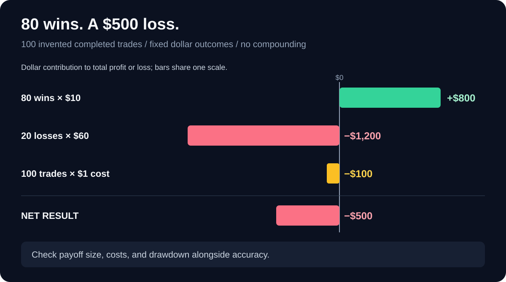

Could I give an AI some money and ask it to trade for me?

I went through regulators' guidance, machine-learning documentation, and a broker's API docs. My first project would be a research notebook for comparing investments, checking assumptions, and testing ideas before any money moves.

## Three different jobs

People use “AI trading” to describe quite different systems:

| Job | What it does | What I would verify |
| --- | --- | --- |
| Research assistant | Reads reports, compares funds, explains risks | Original documents, dates, and calculations |
| Predictive model | Estimates returns, volatility, or other signals | Performance on unseen data, after costs |
| Trading agent | Turns a decision into broker orders | Permissions, position limits, order state |

A language model can help with all three. Summarizing a report and forecasting prices require different evaluations. A bot can also follow ordinary rules without AI.

Robo-advisers are automated portfolio-management services, often using questionnaires about goals and risk. They need not use generative AI. The [SEC's guide](https://www.investor.gov/introduction-investing/general-resources/news-alerts/alerts-bulletins/investor-bulletins-45) covers their fees, portfolios, and human support.

{: .align-center}

## Start with investment research

I would start with a chat tool that accepts documents, a spreadsheet, and two or three current issuer fund factsheets.

My prompt would be:

```text
Help me compare these investments.
First ask about my goal, time horizon, liquidity needs,
risk capacity, country, and account type.

Using the attached issuer documents, compare holdings,
concentration, fees, currency exposure, and stated risks.
Give the document date and page for every factual claim.
Mark missing information instead of guessing.
Explain the strongest argument against each option.
```

This turns investment suggestions into candidates with reasons and trade-offs. I would open the cited pages, recalculate the numbers, and check document dates.

For a company, I would use its filings and ask about revenue, cash flow, debt, and risks to the investment thesis. Keep account numbers, passwords, and unredacted statements out of the conversation. Canada's [AMF guidance](https://lautorite.qc.ca/en/general-public/personal-finances/using-ai-in-personal-finances) covers research uses and privacy limitations.

## If I want to test a trading idea

I would ask AI to write a small, inspectable backtest before building an autonomous agent. For example:

```text
Write a Python backtest for a long-or-cash rule:
after each day's close, compare the 20-day and 50-day
simple moving averages. If the shorter average is higher,
target a long position; otherwise target cash.
Execute changes at the next session's open.

Use a supplied price CSV. State sizing and cost assumptions.
Handle missing data and corporate actions explicitly.
Compare with buy-and-hold over the same evaluation dates.
Report net return, maximum drawdown, turnover, and trades.
Include checks that future rows cannot change past signals.
```

This is a programming exercise, **not an endorsed strategy**. AI helps implement the experiment; usefulness still needs evidence.

The easy mistakes are in the evaluation:

- **Future information:** an earnings figure becomes usable when released, not when its reporting quarter ends.
- **Overfitting:** repeatedly changing parameters after seeing results can turn noise into an impressive chart.
- **Survivorship bias:** testing only today's surviving stocks leaves out failures.
- **Trading friction:** spreads, slippage, fees, and financing can consume a small apparent edge.

[QuantConnect's research guide](https://www.quantconnect.com/docs/v2/writing-algorithms/key-concepts/research-guide) explains these research traps. For learned models, I would train on earlier data, tune on later validation data, and reserve a final untouched period. Fit scalers and feature selection only on training data; account for overlapping prediction horizons at split boundaries. See scikit-learn's [time-series splits](https://scikit-learn.org/stable/modules/generated/sklearn.model_selection.TimeSeriesSplit.html) and [data-leakage guidance](https://scikit-learn.org/stable/common_pitfalls.html#data-leakage).

{: .align-center}

## An 80% win rate can still lose money

Here is an invented set of 100 completed trades, with fixed dollar outcomes and no compounding:

```python
wins, losses = 80, 20
gross = wins * 10 - losses * 60
costs = (wins + losses) * 1  # assumed total cost per round trip
print(gross - costs)        # -500
```

Eighty $10 wins produce $800. Twenty $60 losses consume $1,200. Another $100 in assumed costs leaves **a $500 loss**. These are teaching numbers, not measured returns or a broker's fee schedule.

That is why I would ask about loss size, drawdown, and net performance alongside prediction accuracy.

{: .align-center}

## What I gain, and what can go wrong

| Useful part | Limitation |
| --- | --- |
| Faster reading and comparison | Missing context, stale facts, invented citations |
| Quick prototypes and calculations | Plausible code can contain timing or accounting bugs |
| Consistent monitoring | Bad inputs can trigger repeated bad decisions |
| More hypotheses to investigate | More chances to overfit; market conditions can change |

The [FCA's guidance](https://www.fca.org.uk/investsmart/using-ai-investment-research) covers general-purpose AI's benefits and errors. Promises of “guaranteed AI returns” are also a fraud warning in this [SEC, NASAA, and FINRA alert](https://www.investor.gov/introduction-investing/general-resources/news-alerts/alerts-bulletins/investor-alerts/artificial-intelligence-fraud).

## Before connecting a broker

Next I would use a **paper account** to simulate trading. Alpaca is one example, not a broker recommendation. Its [documentation](https://docs.alpaca.markets/us/docs/paper-trading) lists omissions including market impact, latency-related slippage, queue position, and dividends. Paper results cannot establish live profitability.

For the software, I would put position limits, allowed symbols, data-freshness checks, and a stop switch outside the model. Log the input, decision, checks, order, and fill. After a timeout, check broker order state before retrying; Alpaca's [order API](https://docs.alpaca.markets/us/docs/working-with-orders#using-client-order-ids) supports tracking orders by client ID.

I would begin with manual approval of paper orders and treat any move to real money as a separate decision.

That research notebook can save reading and coding time while leaving me able to check each claim.

*Researched November 11, 2026. This is an engineering workflow and educational example, not a recommendation to buy or sell an investment. I have not established a profitable live AI trading strategy.*
