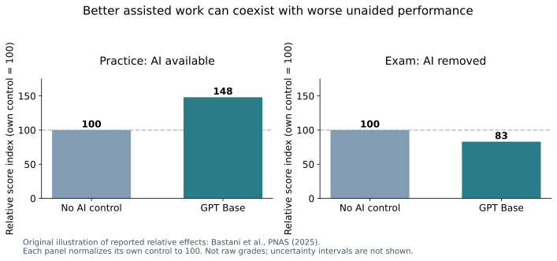
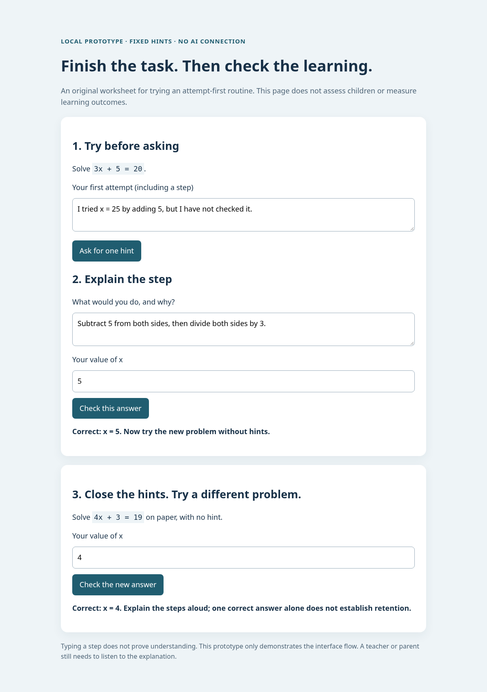

When a student finishes homework faster with AI, it is tempting to call that progress. I care more about what happens when the chat window closes: can they explain the idea, spot a mistake, and solve the next problem?

I looked at research on school mathematics, AI-supported tutoring, and university learning. The evidence supports neither “AI makes children smarter” nor “AI makes them stupid.” It points to something more useful: **how the tool is used can change whether it supports practice or replaces it.**

## Better answers are not always better learning

A [2025 PNAS study by Bastani and colleagues](https://pmc.ncbi.nlm.nih.gov/articles/PMC12232635/) tested GPT-4-based tools with nearly 1,000 students in grades 9–11 at a high school in Turkey. Classes were assigned to ordinary resources, a general-purpose chat interface called GPT Base, or a teacher-informed GPT Tutor that emphasized hints.

With GPT Base, students scored **48% higher on assisted practice**, relative to the control group. But on the subsequent exam **without AI**, they scored **17% lower**. These are relative changes, not percentage-point changes or changes in IQ.

{: .align-center}

The guarded tutor largely removed that exam disadvantage, but did **not** produce a statistically significant exam advantage over the control group. It also included teacher-provided solutions and information about common mistakes. This was more than adding “be a good tutor” to a chatbot.

The study covered four sessions at one school. It demonstrates a real learning risk in that setting, not permanent damage to intelligence or a prediction for every child.

## AI can also help—under different conditions

Two other studies help explain why a blanket verdict is unhelpful:

| Study | What it found | What it does not establish |
|---|---|---|
| [Tutor CoPilot](https://arxiv.org/abs/2410.03017), involving 900 tutors and 1,800 K–12 students | Students whose **human tutors** had AI support were 4 percentage points more likely to master topics. | That children should learn alone with an unrestricted chatbot. |
| [Kestin and colleagues, Scientific Reports, 2025](https://www.nature.com/articles/s41598-025-97652-6), with 194 eligible university physics students | A deliberately designed AI tutor produced better short-term learning outcomes than the comparison active-learning lessons. | The same effect in preschoolers, or better long-term development. |

The second study involved two lessons, not years of follow-up. The first improved the support available to a human teacher. Both are quite different from asking a chatbot to complete a worksheet.

These studies measure particular learning outcomes. They do not establish whether AI changes young children's long-term intelligence, attention, language, or social development. I would not fill that gap with a confident headline.

## “Lazy” and “cheating” need more precise questions

Outsourcing a difficult step can remove an opportunity to practise it. That is a concern about the activity, not proof that a student has become a lazy person. A fluent explanation can also create a misleading feeling of understanding: in the PNAS study, students did not accurately recognize the reduction in their learning.

Cheating is another question. An allowed hint and a submitted AI-written answer are different uses. A [2024 Common Sense Media report](https://www.commonsensemedia.org/research/the-dawn-of-the-ai-era-teens-parents-and-the-adoption-of-generative-ai-at-home-and-school) found that seven in ten teens had used some form of generative AI. That establishes adoption in that survey; it does not mean seven in ten cheated, or that AI caused cheating to increase.

My practical response would be explicit classroom rules: what assistance is allowed, what needs disclosure, and which work must be independent. Ask for intermediate steps, drafts, and a short explanation of the answer. Those give a teacher something concrete to discuss rather than judging understanding from polished final text alone.

## A routine I would use at home or in a classroom

For school-age learners, I would try four steps:

1. **Attempt first.** Write a prediction, a partial solution, or the point of confusion before opening AI.
2. **Ask for a small hint.** Keep the next reasoning step with the learner.
3. **Explain and check.** Have the learner explain why the step works and compare factual claims with a trusted source or teacher.
4. **Try a different problem without AI.** Check again later; one correct answer immediately afterward is not evidence of lasting retention.

This is a practical routine inspired by the distinction between assisted performance and independent learning. It is not a validated intervention of my own.

For a beginner learning programming, I would use a prompt like:

```text
I am learning loops. Here is my code and what I think it does: ...
Ask me to predict the output first.
If I am wrong, give one small hint and wait for my next attempt.
Do not replace the whole program.
Afterward, suggest a similar exercise for me to do without AI.
```

A prompt is a request, not an enforcement mechanism. If the chatbot gives the solution anyway, the adult or teacher still needs to redirect the activity. The research tutors had additional instructional design; this prompt does not reproduce their results.

## I built a small worksheet to try the flow

I made an original browser prototype with a first-attempt field, one fixed hint, answer feedback, and a second problem. [Download the worksheet and check notes](/assets/code/ai-learning-worksheet.zip), unzip it, and open a terminal in the folder:

```bash
python3 -m http.server 8000 --bind 127.0.0.1
```

Open `http://127.0.0.1:8000` in a browser. No package installation, account, or API key is needed. The hint is hard-coded: **this is not an AI tutor**.

I ran the page in Chromium through Playwright, entered a deliberately wrong attempt, requested the hint, corrected the answer, and completed the second problem. The checks confirmed that an empty attempt could not request a hint, the hint did not reveal the answer, and the second problem appeared after the first answer was correct. The hint was hidden for the second problem.

{: .align-center}

This screenshot is from a scripted demonstration, not a child participating in a study. The page does not evaluate the explanation or stop someone typing nonsense to unlock a button. Its tests establish interface behavior, not educational effectiveness.

## What I would do differently for younger children

The studies above do not answer preschool development questions. For young children, I would keep any AI-supported activity adult-led and age-appropriate, respect the service's age requirements, and prioritize conversation, play, reading together, and relationships with people. There is no need for an independent chatbot account to introduce an idea about AI.

I would also avoid entering a child's identifying details, photos, or school records into a general chatbot. [UNESCO's education guidance](https://www.unesco.org/en/articles/guidance-generative-ai-education-and-research) emphasizes age-appropriate use, privacy, and human agency; that is policy guidance, not proof of a learning effect.

For me, the useful measure is not how impressive the AI's answer looks. It is how much the learner can subsequently do, explain, and question on their own. AI can support that process, but the process has to be designed around learning.
