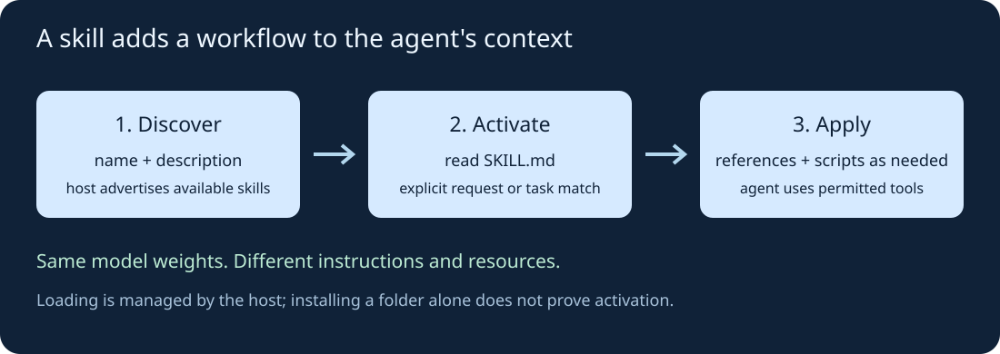
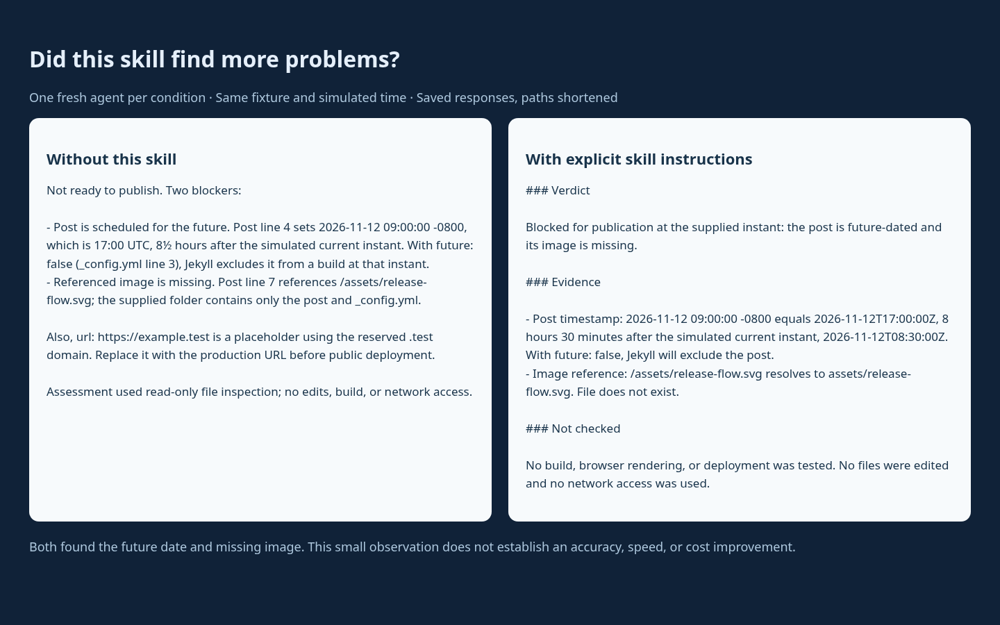

I keep seeing skills recommended as a way to make coding agents better. My first question was simple: if a skill is mostly a Markdown file, how much difference can it make?

After reading the specification and trying a small example, my answer is: **skills can make useful procedures reusable, but installing one does not prove it improves the result.** That second part matters more than the number of skills in the folder.

## What a skill actually is

An Agent Skill is a folder containing a `SKILL.md`, optionally accompanied by scripts, reference documents, or templates. The Markdown starts with a name and description, followed by instructions. It supplies context at runtime; it does not retrain the model or change its weights. [Agent Skills specification](https://agentskills.io/specification).

The host matters. A supporting agent normally sees the skill's metadata first, reads the instructions when it activates the skill, and loads additional resources when needed. This is called *progressive disclosure*: every workflow does not have to be pasted into every conversation.

{: .align-center}

A useful distinction:

| Mechanism | What I use it for |
|---|---|
| A prompt | Instructions for this particular task |
| Repository instructions, such as `AGENTS.md` in Codex | Conventions that apply across work in that repository |
| A skill | A named workflow to select when the task needs it |
| A tool or MCP integration | An operation the agent can call, such as reading a database |

A skill can explain how to use a tool; it does not create that tool or grant access to it. The same instructions pasted directly into a prompt may help too. Packaging primarily changes discovery, reuse, and maintenance.

## Is there evidence that skills help?

There is more than anecdote. **SkillsBench v4** reports matched evaluations across 87 tasks and 18 model–harness configurations. Curated skills raised the aggregate average pass rate from **33.9% to 50.5%**, an increase of **16.6 percentage points**. The reported gains varied by configuration. [Paper, version 4](https://arxiv.org/abs/2602.12670v4).

That is evidence for curated skills on those tasks, not a promise that any downloaded skill makes any agent better. The benchmark also bundles procedural knowledge with the skill condition; it does not establish that a `SKILL.md` file beats giving the agent equivalent information another way.

For my own workflow, I would compare correctness, time, token usage, and unnecessary actions on repeated representative tasks. A skill that produces a longer answer without reducing mistakes may be extra overhead.

## Write one small skill

I chose a familiar task: reviewing a Jekyll post before publication. Two easy-to-miss problems are a future timestamp and a missing image. My skill is deliberately a source review, not a deployment tool.

The folder is:

```text
.agents/skills/jekyll-publish-review/
└── SKILL.md
```

Here is the shape of the file; the [downloadable demo](/assets/code/agent-skills-demo.zip) contains the full version:

```markdown
---
name: jekyll-publish-review
description: Use when reviewing a Jekyll Markdown post for publication readiness, especially scheduled dates and local image references.
---

# Jekyll publication review

1. Read the post frontmatter and _config.yml.
2. Compare the full timestamp, including its UTC offset,
   with the supplied current instant.
3. Check whether future: false excludes the post.
4. Resolve local Markdown image paths and check they exist.
5. Return: Verdict, Evidence, Not checked.

Do not edit or publish files during review.
```

The description gives the agent a reason to select it. The body gives a concrete procedure and an output contract. I would keep this narrow, move lengthy reference material into separate files, and use deterministic scripts for checks that need to be exact. [Authoring guidance](https://www.anthropic.com/engineering/equipping-agents-for-the-real-world-with-agent-skills).

## Install and try it

Unzip the demo, enter `agent-skills-demo/fixture`, and install the local skill:

```bash
mkdir -p .agents/skills/jekyll-publish-review
cp ../skill/SKILL.md .agents/skills/jekyll-publish-review/SKILL.md
```

In a Codex session opened from that folder, explicitly request it:

```text
$jekyll-publish-review
Review this Jekyll post for publishing readiness.
The simulated current instant is 2026-11-12T08:30:00Z.
Report blockers with evidence. Do not edit, build, or use the network.
```

Codex documents repository-local discovery under `.agents/skills`, explicit invocation with `$`, and implicit selection by description. If a change does not appear, restart the session. Other hosts have their own installation and invocation details. [Codex skills documentation](https://developers.openai.com/codex/skills/).

## What happened in my test

I used two fresh subagent contexts in the same managed Codex session, inheriting the same parent model. One reviewed the fixture without this task-specific skill; the other was explicitly told to read the installed skill first. The fixture, simulated clock, and review request were otherwise the same. Other runtime instructions stayed in place.

| Check | Without this skill | With this skill |
|---|---|---|
| Future timestamp: 17:00Z is after 08:30Z | Found | Found |
| Missing `/assets/release-flow.svg` | Found | Found |
| States that no build was run | Yes | Yes |
| Uses the skill's three named sections | No | Yes |

The baseline also flagged the placeholder site URL. So I cannot claim the skill found more problems. It made the report follow a defined format; even the statement about untested behavior was already present in the baseline.

{: .align-center}

*This is a screenshot of a report rendered from the saved responses, with paths shortened, not a screenshot of an agent application's UI. The responses and fixture are included in the download.*

This is one observation per condition, not a statistical benchmark. I tested applying explicitly loaded instructions, not automatic discovery, and did not measure speed or cost. The fixture has a deliberately fixed clock so the date check stays reproducible.

## What I would keep

I would write a skill when I keep repeating a procedure that includes decisions, conventions, and useful references. I would test it on new cases, including tasks where it should stay inactive, before adding more instructions.

I would also read downloaded skills and their scripts before running them: they are instructions and potentially executable code, not just descriptions.

My small test did not show a correctness gain. The stronger reason to keep a skill here is to make a known review procedure easy to invoke and maintain. Whether that saves work over time is something I would measure, rather than assume from a successful demo.
