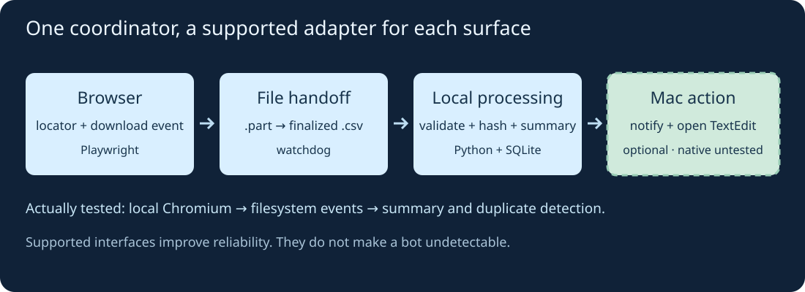
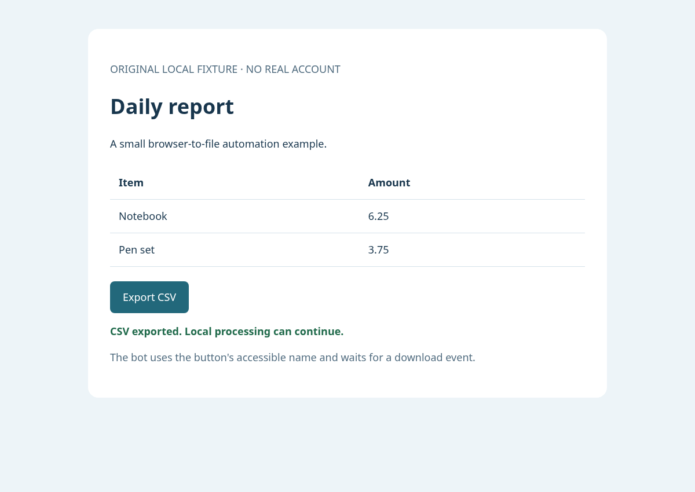

I wanted to understand the Mac equivalent of an AutoIt workflow: watch for something, interact with a website, pass data to another application, and continue without babysitting every click.

My preference is a small coordinator with a different adapter for each surface. A website has a DOM and sometimes an API; a Mac application may expose AppleScript commands; a file export provides a useful handoff between them.

There is one promise I would leave out: **“undetectable.”** A service can recognize automation and restrict it even when the script behaves correctly. Supported interfaces help reliability; they do not make automation invisible. If a service offers an API, I would start with its documented contract and rate limits. An access challenge or rejected automation is a reason to stop and review the integration.

## Which tool belongs where?

[AutoIt](https://www.autoitscript.com/site/autoit/) targets Windows. On macOS, I would choose by task rather than look for a single replacement:

| Surface | My starting point | Why |
|---|---|---|
| Supported web API | HTTP client or the service's SDK | Structured inputs, outputs, and error responses |
| Website UI | [Playwright](https://playwright.dev/python/docs/locators) | Locators and browser events instead of screen coordinates |
| Scriptable Mac app | [AppleScript](https://developer.apple.com/library/archive/documentation/LanguagesUtilities/Conceptual/MacAutomationScriptingGuide/HowMacScriptingWorks.html) or an available Shortcuts action | Commands exposed by the application |
| Hotkeys, windows, local events | [Hammerspoon](https://www.hammerspoon.org/go/) | Lua configuration with Mac-specific automation modules |
| UI without a useful scripting interface | Accessibility-based UI scripting; pixel clicking as a last resort | More dependent on focus, layout, and permissions |

Hammerspoon is particularly interesting for an AutoIt-like desktop setup: its [path watcher](https://www.hammerspoon.org/docs/hs.pathwatcher.html) can react to changes, and its other modules handle hotkeys and windows. But I would not route every browser interaction through mouse coordinates just because the desktop tool can click.

## A small workflow across those boundaries

I built a local example:

1. Playwright opens an original report website and clicks **Export CSV**.
2. It waits for the download to finish, then renames a `.part` file to `.csv`.
3. A [watchdog](https://python-watchdog.readthedocs.io/en/stable/) observer notices the finalized file.
4. Python validates its columns, calculates a summary, and records a content hash in SQLite.
5. An optional macOS adapter shows a notification and opens the summary in TextEdit.

{: .align-center}

**The native boundary matters:** I ran the browser, filesystem watcher, and processing on Linux. I could inspect the Mac adapter against Apple's documentation, but could not execute macOS applications or test the Mac filesystem-event backend here. This is a portable integration demo with an unverified native Mac step.

## Install and run the example

Download the [demo, tests, and recorded output](/assets/code/macos-automation-demo.zip), unzip it, and enter `macos-automation-demo`. I tested Python 3.12, watchdog 7.1.0, and Playwright 1.65.1.

```bash
python3 -m venv .venv
source .venv/bin/activate
python -m pip install -r requirements.txt
python -m playwright install chromium
python -m unittest -v test_demo.py
python demo.py
```

My Linux run used the existing system Chromium through `DEMO_CHROMIUM=/usr/bin/chromium`. The commands above install Playwright's browser for a normal setup; that exact browser installation and the native Mac path were not tested here.

The program starts its own loopback-only web server, launches a browser, exports two identical reports, and processes their filesystem events. It stops after handling the two finalized paths, with a ten-second deadline after the browser work. Browser operations also have their own timeouts. It installs no background service.

The important browser code is short:

```python
with page.expect_download() as info:
    page.get_by_role("button", name="Export CSV").click()

partial = inbox / "report.part"
info.value.save_as(partial)
partial.replace(inbox / "report.csv")
```

This uses the button's accessible name and a [download event](https://playwright.dev/python/docs/downloads). A fixed sleep cannot establish that a download is complete. The final rename is the handoff contract; another program writing directly into a `.csv` file would need a different completion signal.

## What actually happened

On a fresh run, the output was:

```text
SUMMARY: 2 rows; total 10.00
EVENT RESULTS: processed, duplicate
NATIVE ACTIONS: not run (use --mac-actions on macOS)
```

The second report had the same bytes, so its hash was already recorded. Repeating the demo with the existing state produced `duplicate, duplicate` and preserved the summary. Four tests passed: decimal totals, wrong-schema rejection, partial-file filtering, and deduplication after reopening the database.

{: .align-center}

*This is the local fixture in Chromium, not a Mac desktop or a real service account. The report data is synthetic.*

The generated files are in `run/`: `summary.txt`, `evidence.json`, and `browser.png`. This demonstrates the handoff, not a performance benchmark or an anti-bot test.

## Hand the result to a Mac application

The optional native step uses a fixed AppleScript file and passes the message as an argument:

```python
subprocess.run(
    ["/usr/bin/osascript", "notify.applescript", summary],
    check=True, timeout=15,
)
subprocess.run(
    ["/usr/bin/open", "-a", "TextEdit", str(summary_path)],
    check=True, timeout=15,
)
```

The notification script uses Apple's documented [`display notification`](https://developer.apple.com/library/archive/documentation/LanguagesUtilities/Conceptual/MacAutomationScriptingGuide/DisplayNotifications.html) command. The complete demo resolves its script and output paths relative to its own folder. On a Mac, opt in with `python demo.py --mac-actions`; notification visibility depends on your settings. This opens an application visibly, and remains the part that needs native validation.

For a richer application workflow, I would inspect that app's scripting dictionary before adding UI clicks. macOS may request **Automation** permission when one app controls another. **Accessibility** permission is relevant to UI scripting and simulated input; it is not a blanket prerequisite for every file-processing script. Apple's [Automation](https://support.apple.com/guide/mac-help/allow-apps-to-automate-and-control-other-apps-mchl108e1718/mac) and [Accessibility](https://support.apple.com/guide/mac-help/allow-accessibility-apps-to-access-your-mac-mh43185/mac) guides explain the distinction.

## Before leaving it running

For continuous monitoring, I would add startup reconciliation for files that arrived while the watcher was offline, bounded retries, useful logs, and a clear stop control. Filesystem notifications are signals to check state, not proof that an external action happened exactly once.

The demo's hashes prevent repeated local processing of identical content. They do not guarantee exactly-once notifications, application actions, or crash recovery: the summary write and database commit are separate steps. A real cross-app workflow needs an idempotency strategy for each side effect.

I would measure success by whether the bot notices the right event, verifies its result, and recovers predictably when something fails. That makes a mixed Mac-and-browser workflow easier to maintain than a long chain of timed clicks—and is a more useful goal than promising it cannot be detected.
