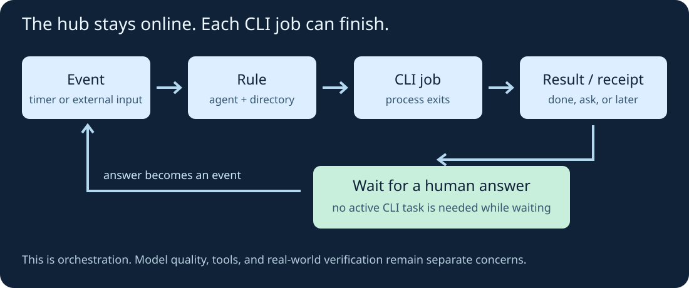
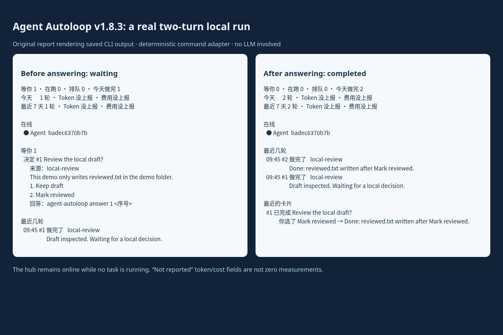

I looked into [Agent Autoloop](https://github.com/KKKKhazix/agent-autoloop) because I wanted to understand what keeps a command-line agent's work moving after its first response. The useful question for me was ordinary: can a job ask for a decision, stop running, and continue when I answer?

I installed **v1.8.3** and tried that sequence locally. It worked with a small deterministic command adapter. That verifies part of the orchestration, not the reasoning quality of an AI model.

## What this project loops

There are several projects with similar names. This article is about **KKKKhazix/agent-autoloop**, an MIT-licensed automation hub for command-line agents.

An event enters the hub, a rule selects an agent and working directory, and a worker starts a CLI process. The process returns a result and exits. Its final response can also contain a structured receipt: ask a question, send a notice, schedule a later check, or emit another event. A human answer becomes input for another round. [Versioned overview](https://github.com/KKKKhazix/agent-autoloop/blob/v1.8.3/README.en.md).

{: .align-center}

The hub remains online while a task waits. The CLI task does not have to stay running during that wait.

This is a different goal from an experiment optimizer such as [Karpathy's autoresearch](https://github.com/karpathy/autoresearch), which modifies training code, evaluates a metric, and keeps or discards experiments. Agent Autoloop supplies event handling and follow-up; the quality of the agent, its task instructions, and the checks around its work still matter.

## Start with one local task

A practical first use would be a local daily brief or a draft that needs a decision before the next step. I would start there before connecting issue trackers or a delivery pipeline.

My demo is intentionally smaller:

1. A `demo.review` event starts a script.
2. The script checks that `draft.txt` is nonempty and asks whether to keep it as a draft or mark it reviewed.
3. It exits without writing a review marker.
4. After I choose **Mark reviewed**, a second round writes `reviewed.txt` and finishes.

“Reviewed” is just a marker in this example. The script does not evaluate writing quality, and no model is involved. The project's supported `command` adapter makes this a useful way to test the hub separately from an LLM. [Adapter documentation](https://github.com/KKKKhazix/agent-autoloop/blob/v1.8.3/docs/plugins.md).

## Install and reproduce it

I tested on Linux with **Node 24.22.1**. The project requires Node 24 or newer. Its runtime can run directly from the checkout without `npm install`; the repository also has development dependencies for its own checks.

Download my [demo and saved CLI evidence](/assets/code/agent-autoloop-demo.zip), unzip it, and enter the `autoloop-demo` directory. You need Node 24+ and Git. These commands use a POSIX shell:

```bash
git clone --depth 1 --branch v1.8.3 \
  https://github.com/KKKKhazix/agent-autoloop.git autoloop-src
node setup.mjs
export AGENT_AUTOLOOP_HOME="$PWD/.autoloop-demo"
node autoloop-src/bin/agent-autoloop.ts check
node autoloop-src/bin/agent-autoloop.ts up
```

The helper creates a fresh local configuration on port **3388**, disables notification channels, and installs no system service. It refuses to overwrite an existing demo data directory. Keep that terminal open.

In a second terminal, in the same folder:

```bash
export AGENT_AUTOLOOP_HOME="$PWD/.autoloop-demo"
node autoloop-src/bin/agent-autoloop.ts emit demo.review --dry-run
node autoloop-src/bin/agent-autoloop.ts emit demo.review
node autoloop-src/bin/agent-autoloop.ts status
```

The dry run checks routing without dispatching work. The actual event should produce a pending decision after the first round finishes. In a fresh demo its card number is normally `1`; use the number shown by `status`:

```bash
node autoloop-src/bin/agent-autoloop.ts answer 1 2
node autoloop-src/bin/agent-autoloop.ts status
```

Option `2` is **Mark reviewed**. Once the second round finishes, inspect `reviewed.txt`. Stop the foreground hub with Ctrl+C in the first terminal.

## How the agent asks a question

The script reads the hub-provided context file through `AGENT_AUTOLOOP_CONTEXT`. When there is no answer yet, it prints a final response containing this receipt:

````text
Draft inspected. Waiting for a local decision.

```agent-autoloop
{"ask":[{
  "title":"Review the local draft?",
  "text":"This demo only writes reviewed.txt in the demo folder.",
  "options":["Keep draft","Mark reviewed"],
  "key":"draft-review"
}]}
```
````

On the next round, it reads the selected answer from the context. A real CLI agent needs to follow the same output protocol, along with its task instructions. The receipt communicates intent; the local program is still responsible for performing the right action. [Protocol](https://github.com/KKKKhazix/agent-autoloop/blob/v1.8.3/docs/protocol.md).

## What I actually observed

Before answering, `status` showed **one waiting decision, zero running tasks, and one completed round**. `reviewed.txt` did not exist.

After answering, it showed **no waiting decisions and two completed rounds**. The file contained:

```text
Reviewed after an explicit local answer.
```

The `why 2` timeline recorded the answer event and the second round's completion. I also exercised the downloadable setup helper in a fresh data directory and got the same two-turn outcome.

{: .align-center}

*This screenshot is of an original report displaying the saved CLI output, not a built-in dashboard. The CLI labels are Chinese: `等你` means waiting for you, `在跑` running, and `做完` completed.*

Token and cost fields said **not reported**. They were not zero measurements. I did not test Codex or Claude conversation resumption, external notification delivery, recovery after a crash, or automatic PR delivery in this experiment.

## Moving from the demo to an AI agent

The normal upstream flow can initialize a logged-in Codex or Claude CLI and run `agent-autoloop try` to exercise a question and continuation. Do that in a separate installation, then validate the exact tools the background agent needs. A desktop agent having browser access does not establish that a background CLI has it too. [Installation guide](https://github.com/KKKKhazix/agent-autoloop/blob/v1.8.3/INSTALL.md).

I would give the first real task a narrow directory, a clear completion check, and an explicit point at which it should ask me. I would also inspect the timeline and provider usage before adding schedules. In this demo, the stopping condition is concrete: one local marker written after a decision.

There is an important permission boundary: the generic `command` adapter does not sandbox an arbitrary program. Instructions to ask before publishing are not a substitute for operating-system or agent-tool permissions. For external actions, I would also design for retries so a repeated run cannot accidentally send or publish twice. The project's [security notes](https://github.com/KKKKhazix/agent-autoloop/blob/v1.8.3/SECURITY.md) describe these boundaries.

My takeaway is that the interesting part is the lifecycle around a task: receiving work, recording what happened, waiting without an active CLI task, and continuing with the decision attached. That is useful plumbing. Whether the agent then does good work still needs a real acceptance check.
